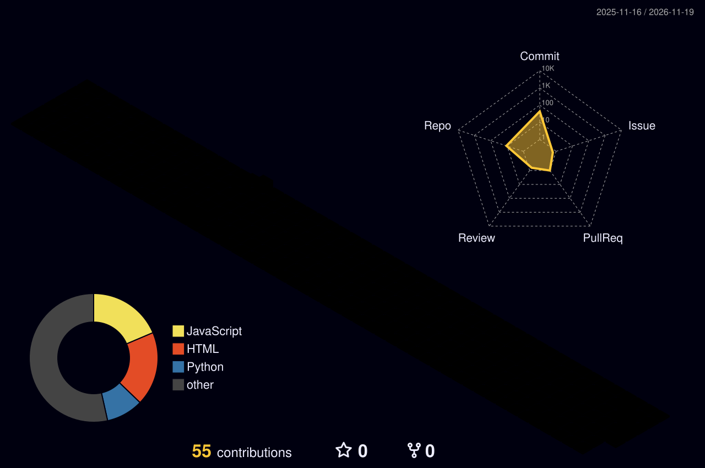

Ingeniero en Sistemas de Información (pensum cerrado, **Universidad Mariano Gálvez**) y **Técnico de TI** con 3 años de experiencia. Administro redes y equipos, brindo soporte a usuarios, reparo hardware y desarrollo sistemas web full stack. Me enfoco en que **todo funcione bien**, desde la infraestructura hasta el código.

- Actualmente **Técnico de TI** en Radio Católica Santa Cruz
- Enfocado en **Redes, Soporte, Ciberseguridad** y **Desarrollo Full Stack**
- Certificación **IT Essentials** (INTECAP)
- San Ildefonso Ixtahuacán, Huehuetenango, Guatemala

### Portal Ciudadano — Municipalidad de San Ildefonso Ixtahuacán
Sistema web integral: reportes ciudadanos con foto y ubicación, seguimiento de obras y portal de transparencia. Bilingüe (Español / Mam) e instalable como app.

`React` · `Node.js` · `PostgreSQL` — **[muniixta.org](https://muniixta.org)**

